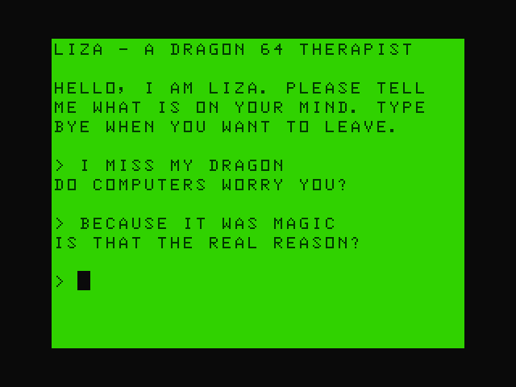
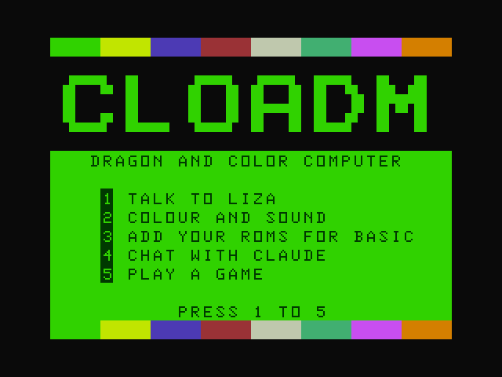

<h1 align="center">CLOADM</h1>

<p align="center"><b>Dragon · Tandy Color Computer · MC-10 in your browser, checked cycle by cycle against MAME where MAME has the hardware.</b></p>

<p align="center">
   I MISS MY DRAGON. DO COMPUTERS WORRY YOU? > BECAUSE IT WAS MAGIC. IS THAT THE REAL REASON?">
</p>

<p align="center">
  <a href="https://cloadm.dev/play/"><b>▶ Play at cloadm.dev</b></a> ·
  <a href="https://cloadm.dev/help/">Help</a> ·
  <a href="docs/using.md">User guide</a> ·
  <a href="#machines">Machines</a> ·
  <a href="docs/verification.md">Verification</a> ·
  <a href="CONTRIBUTING.md">Contributing</a>
</p>

CLOADM (named after the BASIC command that loads machine code from tape) emulates the Dragon 32/64/200, the Tandy
Color Computer 1/2/3, the MC-10 and their clones in a web page. It is plain JavaScript with no build step and no
dependencies, and it is checked instruction by instruction and pixel by pixel against MAME wherever MAME has the
hardware; the exceptions are listed under [How we know it's right](#how-we-know-its-right).

**1,028,112** instructions identical to MAME on the Dragon 64 · **20/20** Dragon 64 display modes pixel-identical ·
**17** models · **0** dependencies · **MIT**

> [!IMPORTANT]
> **Pre-release.** CLOADM is public and usable, but still young: expect rough edges and changes between visits.
> Please [report what breaks](https://github.com/yaniv-golan/cloadm/issues).

> [!NOTE]
> CLOADM includes no ROMs and never downloads them. You supply your own dumps once; they stay in your browser, and CLOADM never uploads them (what Claude reads from the machine's memory, ROM areas included, goes to Anthropic if you use it).
> Without them, a built-in firmware still runs machine-code programs and the programs written for this project.
> [Where to get ROMs →](https://cloadm.dev/roms/)

## Try it

<table>
<tr>
<td width="50%"></td>
<td>

1. **Open [cloadm.dev](https://cloadm.dev/play/).** It's already running: the welcome program, with LIZA one key
   away.
2. **Add your ROMs for BASIC:** drop the files, a folder or a ZIP on the screen. Names don't matter.
   [Where to get ROMs →](https://cloadm.dev/roms/)
3. **Drop a program on it:** a `.cas` tape, a `.bin`, a `.rom` cartridge or a BASIC listing. With
   ROMs, CLOADM restarts the machine and types `CLOADM` and `EXEC` (or `CLOAD` and `RUN`) for you.

</td>
</tr>
</table>

Something not working? The [quick fixes](https://cloadm.dev/help/#fixes) cover a black screen, no sound, a tape
that won't load, a disk that shows nothing and the keyboard.

## Use it from code or an agent

`node cli/cloadm.js --program liza --screen` runs a program headless and prints the screen. In Claude Code:
`/plugin marketplace add yaniv-golan/CLOADM`, then `/plugin install cloadm`.
Guides: [docs/automation.md](docs/automation.md) and [docs/mcp.md](docs/mcp.md).

## Machines

| | Machine | CPU · video | Against MAME |
|---|---|---|---|
| **DRAGON** | Dragon 32, Dragon 64, Dragon 200, Dragon 200-E, Tano Dragon 64 | 6809 (6309 option on the 64 and Tano) · MC6847 | ✅ trace · ✅ video 20/20, PAL colour blending included on the PAL models |
| **DRAGON** | Dragon 64 Plus: a second, 80-column screen | 6809 · MC6847 + HD6845S CRTC | ✅ trace · ✅ 80-column screen geometry (see [verification](docs/verification.md)) |
| **DRAGON** | Dragon Professional (Alpha): AY-3-8912 sound, built-in disk interface | 6809 · MC6847 | ✅ trace · ✅ video 20/20 · ✅ disk images byte-identical · ✅ sound within a stated tolerance |
| **COCO** | CoCo 1/2 (6309 option), CoCo 2B (MC6847T1 with lowercase), Prológica CP 400 | 6809 · MC6847 / T1 | ✅ trace · ✅ video 20/20, artifact colours included on the 1/2 and 2B |
| **COCO 3** | CoCo 3, 128K / 512K (6309 option) | 6809 · GIME | ✅ trace · ⚠️ video 34/49, the rest differ only in text glyph shapes · ⚠️ PAL not verified |
| **MC-10** | MC-10, Matra Alice | 6803 · MC6847 | ✅ trace · ✅ video 20/20 on the MC-10 |
| **CLONES** | Dynacom MX-1600, LZ Color64, Codimex CD-6809 | 6809 · MC6847 | ✅ trace |

Pick the machine from the menu at the top left of the emulator. RAM, CPU and the CPU rate are in Machine settings (in the settings drawer, or **RAM, CPU and speed…** in the machine menu).
Per-machine notes, RAM options and the chip-by-chip list: [docs/machines.md](docs/machines.md).

## What works

| | Today | Coming |
|---|---|---|
| **Cassette** | `.CAS` played as a real signal through the cassette port, WAV recordings in, fast loading, the tape counter, the tape's progress on the screen's border while it loads, Tape sound (the tape heard as a recorder's speaker plays it); `CSAVE`/`CSAVEM` saved as `.CAS` or `.WAV` | The tape signal through the machine's own sound (`AUDIO ON`: MAME 0.264 mixes none in) |
| **Floppy** | DragonDOS (WD2797), Premier / Delta (WD2791) and RS-DOS (WD1773) cartridges; VDK, JVC (`.dsk`) and DMK images read and written, headerless NitrOS-9 / OS-9 `.dsk` images included; new blank disks; 4 drives, write-protect; booting NitrOS-9 Level 2 on the CoCo 3 from your own floppy image, no ROM needed ([how](docs/using.md#booting-nitros-9)) | Booting NitrOS-9 from 80-track floppies |
| **Cartridges** | ROM cartridges, banked ROM cartridges up to 128K, Games Master, Orchestra-90, Multi-Pak (with a disk cartridge in slot 4); the Speech/Sound Pak on the CoCo 1/2, CoCo 2B, CoCo 3 and the Dragon 64, music only (its sound is not yet verified against MAME) | Speech/Sound Pak speech |
| **Printer, serial, DriveWire** | Printer; bit-banger and the Dragon 64's 6551 with a terminal or loopback plug; a DriveWire 4 server in the browser over the CoCo's Becker port; booting NitrOS-9 Level 2 on the CoCo 3 from your own DriveWire image, no ROM needed ([how](docs/using.md#booting-nitros-9)); serving a real CoCo over Web Serial (untested on hardware) | |
| **Input** | Translated and positional keyboard, keyboard joystick, gamepads, Hi-Res interfaces, the CoCo 3 mouse; an on-screen keyboard and joystick on phones and tablets | |
| **Games** | 2048 and Minesweeper, our own, no ROMs needed (32K or more): welcome menu option 5, or [`?start=2048`](https://cloadm.dev/play/?start=2048) / [`?start=minesweeper`](https://cloadm.dev/play/?start=minesweeper) ([details](docs/using.md#games)) | |
| **Library** | Every tape, disk, cartridge and program you load, kept for next time, in the browser or a folder on your computer; paste a magazine listing and CLOADM types it in | |
| **Claude** | Chat with Claude full screen on the green screen (phones included), or Ask Claude in a side panel; Claude reads only the emulated machine (its screen text and memory, never anything else on your computer; it says so when it can't read a screen), and acts on it (POKE, typing, loading a BASIC program, BREAK) only with your permission, with undo | The chat over DriveWire to a real machine; the CoCo 3's 80-column chat screen |
| **Tools** | Assembler, Debugger, POKE book, snapshots; a command line, MCP server and Node API for agents ([automation](docs/automation.md), [MCP](docs/mcp.md)) | Step back (rewind) |
| **Sharing** | Every setting as a URL parameter; a link that opens exactly this moment, a 6-second clip, a true-pixel screenshot; embed code and a JavaScript API; works offline once visited; **Install CLOADM…** at the foot of the **machine menu** (the machine-name button, top left), and a one-time offer once a program has run a minute (its own window, offline) | |

How to load each kind of file, the keys, snapshots, sharing and embedding: [docs/using.md](docs/using.md). Running it from scripts and CI (`node cli/cloadm.js`): [docs/automation.md](docs/automation.md). Writing a game and testing it end to end (keys, screen, pictures, sound), with a starter game: [docs/game-development.md](docs/game-development.md).

## ROMs: bring your own

The BASIC, DOS and character-generator ROMs are copyrighted by their owners (Microsoft, Tandy, Dragon Data and
others). CLOADM doesn't include them, doesn't download them and doesn't fetch them on your behalf, and its tests
never use them.

* **Own the machine?** Dumping the ROMs from your own hardware is the cleanest route. A dump that comes out as one
  combined file is fine: CLOADM splits it.
* **Looking for the files?** [Where to get ROMs](https://cloadm.dev/roms/) says where the ROM sets XRoar uses are
  kept. That site isn't part of this project, and whether you may download from it depends on the law where you
  live and on the copyright holders' terms.
* **Drop them on the page,** with any file names. CLOADM recognises each ROM by its CRC32, puts it in the right
  socket for every machine it fits, and keeps it in your browser only. CLOADM itself never uploads your ROMs and never
  puts them in share links or exported settings. If you use Claude, what it reads from the machine's memory (ROM
  areas included) is sent to Anthropic as part of your conversation. **Save ROM pack…** carries them to another browser.
* **Add ROMs** (in the header) shows each socket, what it needs and what each file you dropped turned out to be.

What each machine needs:

<!-- rom-table:start (generated by tools/gen-rom-docs.js) -->
| Machine | Required | Optional | Total size |
|---|---|---|---|
| Dragon 32 | Dragon 32 BASIC (16K) | – | 16K |
| Dragon 64 | 32K-mode BASIC (16K) | 64K-mode BASIC (16K) | 32K |
| Dragon 200 | 32K-mode BASIC (16K) | 64K-mode BASIC (16K) | 32K |
| Dragon 200-E | 32K-mode BASIC (16K), Character generator (4K) | 64K-mode BASIC (16K) | 36K |
| Tano Dragon 64 | 32K-mode BASIC (16K) | 64K-mode BASIC (16K) | 32K |
| Dragon Professional (Alpha) | Boot ROM (8K), BASIC (16K) | – | 24K |
| Dragon 64 Plus | 32K-mode BASIC (16K), Character generator (80-column board) (8K) | 64K-mode BASIC (16K), Timing PROM (not used) (0.5K) | 40.5K |
| CoCo 1/2 | Color BASIC (8K) | Extended Color BASIC (8K) | 16K |
| CoCo 2B | Color BASIC (8K) | Extended Color BASIC (8K) | 16K |
| Dynacom MX-1600 | Color BASIC (8K) | Extended Color BASIC (8K) | 16K |
| LZ Color64 | Color BASIC (8K) | Extended Color BASIC (8K) | 16K |
| Codimex CD-6809 | Color BASIC (8K) | Extended Color BASIC (8K) | 16K |
| Prológica CP-400 | CP 400 BASIC (16K) | – | 16K |
| CoCo 3 | Super Extended Color BASIC (32K) | – | 32K |
| CoCo 3 (PAL) | Super Extended Color BASIC (32K) | – | 32K |
| MC-10 | Micro Color BASIC (8K) | – | 8K |
| Matra Alice | BASIC (8K) | – | 8K |
<!-- rom-table:end -->

Disk BASIC (RS-DOS, DragonDOS) lives in the disk cartridge, not the computer; CLOADM recognises those
ROMs and uses them in the disk cartridges. Every socket, alias and the CRC32 of every known-good dump are in
[docs/roms.md](docs/roms.md).

## How we know it's right

Both CLOADM and MAME run diagnostic firmware written for this project, in lockstep, with no copyrighted ROM. Every
instruction's registers and cycle count must match, every display mode must match pixel for pixel, disk images
written by both must be byte-identical, and cartridge sound is compared with MAME's recording. A regression gate
(`node tests/regress.test.js`) replays the verified traces and frames in seconds after every change. Where MAME and
the hardware disagree, the hardware wins and the difference is documented.

This holds where MAME has the hardware. The exceptions: the CoCo 3's video is 34/49 identical (the rest differ only
in text glyph shapes); the PAL CoCo 3 cannot be verified, because MAME does not run a PAL field for it; the
Speech/Sound Pak's sound is not yet compared with MAME; and the clones (Dynacom MX-1600, LZ Color64, Codimex
CD-6809) and the Matra Alice are compared by instruction trace only, not by video.

MAME 0.264 is the reference. A few areas are compared on MAME 0.289; [docs/verification.md](docs/verification.md)
lists them, with the results for every machine and device.

## LIZA and Claude

In 1983 a computer that talked back was a trick. **LIZA**, written for this project, is that trick: ELIZA-style
keyword matching in 3 KB of 6809. It runs with no ROMs: press 1 on the Welcome menu, or open
[cloadm.dev/play/?start=liza](https://cloadm.dev/play/?start=liza).

**Claude** is the same machine forty years on: press 4 on the Welcome menu, or open
[cloadm.dev/play/?app=claude](https://cloadm.dev/play/?app=claude). (The games have links of their own too:
[?start=2048](https://cloadm.dev/play/?start=2048) and [?start=minesweeper](https://cloadm.dev/play/?start=minesweeper);
every program in the Media tab's "Runs without ROMs" is a link you can copy.) Firmware written for this project replaces
BASIC and holds the conversation on the green screen, in a lowercase font drawn by the machine itself. Claude can
work on the BASIC session kept alongside the chat: read its screen and memory, POKE, type in short programs or load longer ones (asking first) and RUN them,
press BREAK, and one click undoes it all. It runs on your own Anthropic API key, kept in your browser and never
visible to the emulated machine, snapshots, share links or exported settings. What Claude reads from the machine's memory (ROM
areas included) is sent to Anthropic as part of your conversation. More in [docs/claude.md](docs/claude.md).

## FAQ

* **Why do I need ROMs?** BASIC and the DOS are copyrighted; CLOADM can't ship them. Without them it still runs
  machine-code programs, LIZA, the welcome program and its two games.
* **Does it work on a phone?** Yes: an on-screen keyboard appears, split for the thumbs when held sideways,
  and a switch turns it into a touch joystick (stick and FIRE) for games.
* **Does it work offline?** Yes, after one visit. Browsers offer to install it, and **Install CLOADM…** at the foot
  of the **machine menu** (the machine-name button, top left) makes it an app of its own (its own window, offline);
  the page offers it once a program has run for a minute.
* **Where are my ROMs and programs kept?** In your browser's private storage, or a folder you choose. CLOADM itself never
  uploads them. If you use Claude, what it reads from the machine's memory (ROM areas included) is sent to Anthropic as
  part of your conversation.
* **Where does my Anthropic API key go?** It stays in this browser and goes only to Anthropic's API, never into the
  machine, snapshots, share links or exported settings.
* **How does it compare to XRoar, MAME and VCC?** [docs/comparison.md](docs/comparison.md).
* **Which keys are BREAK and CLEAR?** `Esc` and `Home`. The rest: [docs/using.md](docs/using.md#keys).

## Why this exists

I was thirteen, in Israel, in 1983, when my parents gave me a Dragon 64 for my Bar Mitzvah. Not a Dragon 32: a 64.

It started with my dad's Casio FX-702P, a programmable calculator from 1981 with a one-line screen and a BASIC
interpreter. I learned to program from its manual. You wrote a line, and it ran it. That was magic. Then came a
ZX81, in an afternoon programming course in the basement of our school.

There was no internet, and computer books and magazines were hard to find in Israel. Whenever my dad or anyone
else flew to the US, they came back with my magazines in their suitcase. I spent countless hours on the Dragon,
and I still know some of its PEEKs and POKEs by heart.

CLOADM is that machine, switched on again, made exact enough to trust and simple enough to open in a browser
tab. — Yaniv

Some of them:

```
POKE 65495,0
POKE 65494,0
EXEC
?PEEK(25)*256+PEEK(26)
```

## Contributing

Bug reports and pull requests are welcome: [open an issue](https://github.com/yaniv-golan/cloadm/issues). To run it
locally, serve the repository with any static server (`python3 -m http.server`) and open `/play/`; `node
tests/all.js` runs every test. There is no `package.json`, on purpose: nothing to install, so run `node tests/all.js`
rather than `npm test`. Changes follow [AGENTS.md](AGENTS.md): nothing counts as done until it passes the proof it asks for, which includes
matching MAME wherever the change touches hardware behaviour.
[CONTRIBUTING.md](CONTRIBUTING.md) also says how to put your own program on the shelf of programs that run without
ROMs. The internals: [docs/architecture.md](docs/architecture.md) and [docs/development.md](docs/development.md).

## Credits

CLOADM is built on decades of other people's work: [MAME](https://www.mamedev.org/) and the authors of its Dragon
and CoCo drivers, [XRoar](https://www.6809.org.uk/xroar/) by Ciaran Anscomb, [VCC](https://github.com/VCCE/VCC),
the Color Computer Archive, the Dragon Archive, DriveWire, and everyone who documented the SAM, VDG and GIME. The
full list is in [CREDITS.md](CREDITS.md). Missing someone? Please open a pull request.

## License

[MIT](LICENSE). It covers the emulator's own code and firmware, not the machines' ROMs, which belong to their
copyright holders and are never included. "Dragon", "Tandy", "TRS-80", "Color Computer", "MC-10", "Matra Alice",
"Prológica CP-400" and the other product names used here are trademarks of their respective owners. CLOADM is an
independent project, not affiliated with or endorsed by any of them. Changes: [CHANGELOG.md](CHANGELOG.md).
Security: [SECURITY.md](SECURITY.md).
